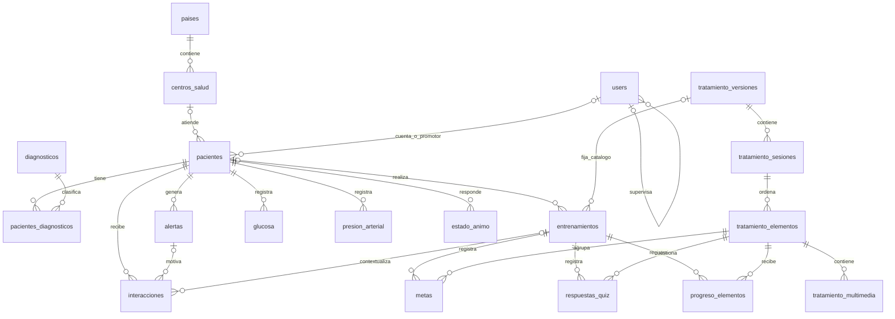

# Diccionario de datos de COLMA

Fecha de revisión: 21 de octubre de 2026.

Este documento describe el esquema resultante de aplicar las migraciones del
repositorio hasta `2026_10_15_000000_add_oculto_to_pacientes_table.php`. Las
migraciones determinan tipos, nulabilidad, valores predeterminados y restricciones;
los modelos, servicios y validaciones aportan el significado funcional. No es un
relevamiento de una base de datos desplegada.

El catálogo y la sincronización se complementan con
[Tratamientos y progreso](tratamientos-y-progreso.md).

## Convenciones

- **PK**: clave primaria. Salvo indicación expresa, `id` es `bigint unsigned`
  autoincremental, obligatorio y sin significado funcional.
- **FK**: clave foránea física. Los identificadores FK son `bigint unsigned`.
  Una referencia indicada como lógica no tiene restricción FK en la base.
- **Nulo** indica si la columna admite `NULL` en la base. La API o los formularios
  pueden exigir valores aunque la columna sea nullable.
- `string(n)` representa `varchar(n)`; `string` sin longitud equivale a 255.
  `bool` representa el booleano de Laravel; su representación física depende del
  motor. Los tipos se expresan conforme a las migraciones de Laravel.
- **Auditoría** agrega `created_at` y `updated_at`, ambos `timestamp` nullable,
  gestionados por Eloquent. **Borrado lógico** agrega `deleted_at`, `timestamp`
  nullable: borrar lógicamente no ejecuta las acciones de una FK.
- Si no se indica un valor predeterminado, la migración no declara uno. `NULL`
  representa ausencia; no equivale a cadena vacía, cero o `false`.
- Los instantes se almacenan en UTC. Las columnas `date` y `time` de agenda
  representan fechas y horas locales. El panel muestra instantes según el país
  del usuario: `AR` → `America/Argentina/Buenos_Aires`, `PE` → `America/Lima`;
  sin país reconocido usa Argentina.

## Relaciones principales

Las tablas de progreso, respuestas y metas también tienen FK directa a pacientes.
Las reglas de unicidad y pertenencia se detallan debajo; el diagrama no expresa
las restricciones de negocio.

## Personas y catálogos

### `paises` — Países de operación (`Pais`)

Sin auditoría.

| Campo | Tipo | Nulo | Descripción / predeterminado |
|---|---|---|---|
| `id` | PK | No | Identificador del país. |
| `nombre` | string(100) | No | Nombre del país. |
| `codigo` | string(10) | Sí | Código único; se usan `AR` y `PE`. |
| `activo` | bool | No | Habilitación; `true`. |

### `centros_salud` — Centros de atención (`CentroSalud`)

Sin auditoría.

| Campo | Tipo | Nulo | Descripción / predeterminado |
|---|---|---|---|
| `id` | PK | No | Identificador del centro. |
| `nombre` | string(150) | No | Nombre del centro. |
| `pais_id` | FK → paises.id | Sí | País del centro. |
| `activo` | bool | No | Habilitación; `true`. |

### `users` — Cuentas de acceso y personal (`User`)

Con auditoría y borrado lógico. Los roles se asignan mediante Bouncer.

| Campo | Tipo | Nulo | Descripción / predeterminado |
|---|---|---|---|
| `id` | PK | No | Identificador de cuenta; corresponde a `userId` en la API móvil. |
| `nombre` | string | No | Nombre del usuario. |
| `sexo` | enum(M, F) | No | Sexo registrado. |
| `documento` | string(20) | No | Documento único. |
| `email` | string | Sí | Correo único cuando está informado. |
| `password` | string | No | Contraseña almacenada como hash mediante el cast `hashed`. |
| `pais_id` | FK → paises.id | Sí | País y referencia para el huso horario. |
| `centro_salud_id` | FK → centros_salud.id | Sí | Centro asignado. |
| `supervisor_id` | FK → users.id | Sí | Supervisor del usuario. |
| `accesos` | integer | No | Contador de accesos; `0`. |
| `ultimo_acceso` | datetime | Sí | Último acceso registrado. |
| `remember_token` | string(100) | Sí | Token de sesión recordada. |

Roles definidos en `User`: `superusuario`, `supervisor`, `supervisor_pais`,
`promotor` y `paciente`. `password` y `remember_token` se ocultan al serializar
el modelo.

### `pacientes` — Ficha del participante (`Paciente`)

Con auditoría y borrado lógico.

| Campo | Tipo | Nulo | Descripción / predeterminado |
|---|---|---|---|
| `id` | PK | No | Identificador clínico, distinto del ID de cuenta. |
| `user_id` | FK → users.id | Sí | Cuenta de acceso a la app. |
| `id_externo` | string(50) | Sí | Identificador externo único cuando está informado. |
| `nombre` | string(100) | No | Nombre del paciente. |
| `apellido` | string(100) | No | Apellido del paciente. |
| `fecha_nacimiento` | date | No | Fecha de nacimiento. |
| `sexo` | enum(M, F) | No | Sexo registrado. |
| `documento` | string(20) | No | Documento único entre pacientes. |
| `telefono` | string(30) | No | Teléfono principal. |
| `telefono2` | string(30) | Sí | Teléfono alternativo. |
| `email` | string(100) | Sí | Correo de contacto, sin índice único. |
| `direccion` | string | No | Domicilio. |
| `referencia` | string | Sí | Referencia del domicilio. |
| `observaciones` | text | Sí | Notas de la ficha. |
| `centro_salud_id` | FK → centros_salud.id | Sí | Centro de atención; determina el país del tratamiento. |
| `promotor_id` | FK → users.id | Sí | Promotor responsable. |
| `fecha_enrolamiento` | date | No | Fecha de incorporación. |
| `activo` | bool | No | Estado de participación; `true`. |
| `fecha_ultima_sincronizacion` | timestamp | Sí | Última sincronización registrada. |
| `fecha_primer_login_app` | timestamp | Sí | Primer ingreso a la app. |
| `clave` | text | Sí | Contraseña cifrada con `Crypt::encryptString`; distinta del hash de `users.password`. |
| `test` | bool | No | Paciente de prueba; `false`. |
| `oculto` | bool | No | Exclusión de estadísticas; `false`. Conserva acceso a ficha, listados y app. |

La relación Eloquent cuenta–paciente es `hasOne`, pero `user_id` no tiene índice
único. Las estadísticas que usan `paraEstadisticas` excluyen tanto `oculto=true`
como `test=true`.

### `diagnosticos` — Diagnósticos disponibles (`Diagnostico`)

Sin auditoría.

| Campo | Tipo | Nulo | Descripción / predeterminado |
|---|---|---|---|
| `id` | PK | No | Identificador del diagnóstico. |
| `nombre` | string(150) | No | Nombre único. |
| `activo` | bool | No | Habilitación; `true`. |

### `pacientes_diagnosticos` — Diagnósticos del paciente

Con auditoría. Resuelve la relación muchos a muchos.

| Campo | Tipo | Nulo | Descripción |
|---|---|---|---|
| `id` | PK | No | Identificador de asociación. |
| `paciente_id` | FK → pacientes.id | No | Paciente diagnosticado. |
| `diagnostico_id` | FK → diagnosticos.id | No | Diagnóstico asociado. |

No se declara unicidad para el par paciente–diagnóstico.

## Mediciones y estado de ánimo

Las tres tablas siguientes no tienen `created_at`, `updated_at` ni borrado lógico.
Cada una incluye estos campos comunes:

| Campo | Tipo | Nulo | Descripción |
|---|---|---|---|
| `id` | PK | No | Identificador del servidor. |
| `id_app` | integer | Sí | Identificador del registro en el dispositivo. |
| `paciente_id` | FK → pacientes.id | No | Paciente de la medición. |
| `fecha_registro` | timestamp | No | Fecha de registro recibida de la app. |
| `fecha_usuario` | timestamp | No | Fecha de la medición/respuesta informada por el usuario. |
| `fecha_sincronizacion` | timestamp | No | Fecha de sincronización recibida de la app. |

En cada tabla es único `(paciente_id, id_app)`. Un `id_app=NULL` no identifica un
reintento y permite varias filas. La API exige el identificador local aunque la
base admita `NULL`.

### `glucosa` — Mediciones de glucemia (`Glucosa`)

Además de los campos comunes:

| Campo | Tipo | Nulo | Descripción |
|---|---|---|---|
| `valor_mgdl` | integer | No | Glucemia en mg/dL. |
| `ayuno` | bool | No | Medición en ayunas. |
| `advertencia` | enum(Baja, Normal, Alta) | Sí | Clasificación clínica; cast `AdvertenciaClinica`. Obligatoria en la API. |

### `presion_arterial` — Mediciones de presión (`PresionArterial`)

Además de los campos comunes:

| Campo | Tipo | Nulo | Descripción |
|---|---|---|---|
| `presion_sistolica` | integer | No | Presión sistólica en mmHg. |
| `presion_diastolica` | integer | No | Presión diastólica en mmHg. |
| `advertencia` | enum(Baja, Normal, Alta) | Sí | Clasificación clínica; cast `AdvertenciaClinica`. Obligatoria en la API. |

Índice adicional `(paciente_id, fecha_registro)` para consultas históricas.
El atributo Eloquent `valor` concatena ambas presiones; no es una columna.

### `estado_animo` — Cuestionario de ánimo (`EstadoAnimo`)

Además de los campos comunes:

| Campo | Tipo | Nulo | Descripción |
|---|---|---|---|
| `pregunta_1` a `pregunta_9` | integer, nueve columnas | No | Respuesta individual a cada pregunta. |
| `valor` | integer | No | Puntaje total: el servidor suma las nueve respuestas. |

La validación actual exige respuestas numéricas; no declara un rango por pregunta.

## Entrenamientos y catálogo de tratamientos

### `entrenamientos` — Ciclos de seguimiento (`Entrenamiento`)

Con auditoría. Un entrenamiento conserva su versión del catálogo aunque se
importen versiones nuevas. El entrenamiento activo contextualiza progreso y datos
funcionales; `activo` no cuenta con una restricción única por paciente.

| Campo | Tipo | Nulo | Descripción / predeterminado |
|---|---|---|---|
| `id` | PK | No | Identificador del ciclo. |
| `paciente_id` | FK → pacientes.id | Sí | Paciente del ciclo. |
| `tratamiento_version_id` | FK → tratamiento_versiones.id | Sí | Versión fijada para este entrenamiento. |
| `fecha` | date | No | Fecha del entrenamiento. |
| `seguimientos_mensuales` | tinyint unsigned | No | Cantidad de seguimientos mensuales del circuito; `5`. |
| `seguimiento_dos_semanas_inicio` | date | No | Inicio de la ventana de seguimiento a dos semanas. |
| `seguimiento_dos_semanas_fin` | date | No | Fin de esa ventana. |
| `llamada_mensual_1_inicio`, `llamada_mensual_1_fin` | date, dos columnas | No | Ventana de la llamada mensual 1. |
| `llamada_mensual_2_inicio`, `llamada_mensual_2_fin` | date, dos columnas | No | Ventana de la llamada mensual 2. |
| `llamada_mensual_3_inicio`, `llamada_mensual_3_fin` | date, dos columnas | No | Ventana de la llamada mensual 3. |
| `llamada_mensual_4_inicio`, `llamada_mensual_4_fin` | date, dos columnas | No | Ventana de la llamada mensual 4. |
| `llamada_mensual_5_inicio`, `llamada_mensual_5_fin` | date, dos columnas | No | Ventana de la llamada mensual 5. |
| `agendar_cita_final_inicio` | date | No | Inicio de la ventana para agendar el cierre. |
| `agendar_cita_final_fin` | date | No | Fin de esa ventana. |
| `activo` | bool | No | Ciclo activo; `true`. |
| `user_id` | FK → users.id | Sí | Usuario asociado al registro del entrenamiento. |

Las ventanas se calculan desde `fecha` mediante `Entrenamiento::diasSuma`.
La cantidad de sesiones y la completitud se derivan del catálogo y del progreso;
no existe una columna vigente `sesiones`.

### `tratamiento_versiones` — Versiones del catálogo (`TratamientoVersion`)

Con auditoría. Fuente de importación:
`storage/app/private/tratamientos/content.json`.

| Campo | Tipo | Nulo | Descripción |
|---|---|---|---|
| `id` | PK | No | Identificador de versión. |
| `pais` | string(10) | No | Código de país; referencia lógica, sin FK a `paises`. |
| `tipo` | string(50) | No | Identificador lógico del tratamiento; el servicio selecciona `DIABETES`, `HTA` o `DBT_HTA`. |
| `hash` | string(64) | No | SHA-256 del contenido lógico y checksums de los recursos. |
| `contenido` | json | Sí | Objeto completo del tratamiento importado; cast a array. |

Único `(pais, tipo, hash)`. Índice `(pais, tipo, created_at, id)` para recuperar
la última versión. Un cambio de contenido o de bytes de recursos crea una versión.

### `tratamiento_sesiones` — Sesiones de una versión (`TratamientoSesion`)

Con auditoría.

| Campo | Tipo | Nulo | Descripción |
|---|---|---|---|
| `id` | PK | No | Identificador de sesión. |
| `tratamiento_version_id` | FK → tratamiento_versiones.id | No | Versión propietaria. |
| `semana` | integer unsigned | No | Número de semana declarado por el catálogo. |
| `sesion` | integer unsigned | No | Número de sesión dentro de la semana. |
| `contenido` | json | Sí | Objeto de subsesión importado; cast a array. |

Único `(tratamiento_version_id, semana, sesion)`.

### `tratamiento_elementos` — Unidades de contenido (`TratamientoElemento`)

Con auditoría. Todos los tipos cuentan para completitud.

| Campo | Tipo | Nulo | Descripción |
|---|---|---|---|
| `id` | PK | No | Identificador que intercambia la API como `tratamiento_elemento_id`. |
| `tratamiento_sesion_id` | FK → tratamiento_sesiones.id | No | Sesión propietaria. |
| `tipo` | string(50) | No | `DESCRIPTION`, `VIDEO`, `QUIZ` o `METAS`, validados al importar. |
| `orden` | integer unsigned | No | Índice base cero en `multimedia[]` de la subsesión. |
| `contenido` | json | No | Objeto lógico del elemento; cast a array. Incluye preguntas/opciones para QUIZ y opciones de actividades para METAS. |

Único `(tratamiento_sesion_id, orden)`. `tipo` es una cadena en la base;
la lista de valores permitidos se impone en el importador.

### `tratamiento_multimedia` — Archivos físicos (`TratamientoMultimedia`)

Con auditoría. Los archivos pertenecen a un elemento; la sesión se obtiene a
través de él.

| Campo | Tipo | Nulo | Descripción |
|---|---|---|---|
| `id` | PK | No | Identificador interno del recurso. |
| `tratamiento_elemento_id` | FK → tratamiento_elementos.id | No | Elemento propietario. |
| `ruta` | string | No | Ruta del recurso declarado en el catálogo. |
| `tipo` | string(50) | No | `AUDIO`, `IMAGE` o `VIDEO`, validados al importar. |
| `checksum` | string(64) | No | SHA-256 de los bytes del archivo. |

Único `(tratamiento_elemento_id, ruta)`. Una ruta puede reaparecer en versiones
distintas. DESCRIPTION admite AUDIO e IMAGE opcionales, VIDEO exige un VIDEO,
y QUIZ/METAS no tienen archivos físicos.

## Progreso y datos funcionales

Las tres tablas de esta sección tienen auditoría. Sus tres FK de contexto son
obligatorias. La aplicación comprueba que el elemento pertenezca a la versión
del entrenamiento; las FK por separado no garantizan esa correspondencia ni que
el paciente sea el dueño del entrenamiento.

### `progreso_elementos` — Estado pedagógico (`ProgresoElemento`)

| Campo | Tipo | Nulo | Descripción |
|---|---|---|---|
| `id` | PK | No | Identificador del servidor. |
| `paciente_id` | FK → pacientes.id | No | Paciente que realizó el elemento. |
| `entrenamiento_id` | FK → entrenamientos.id | No | Ciclo en el que se registra. |
| `tratamiento_elemento_id` | FK → tratamiento_elementos.id | No | Unidad pedagógica. |
| `completado` | bool | No | Estado actual reversible; no tiene predeterminado. |
| `fecha_estado` | timestamp | No | Instante del estado comunicado por el dispositivo. |
| `fecha_sincronizacion` | timestamp | No | Fecha de sincronización recibida. |

Único `(paciente_id, entrenamiento_id, tratamiento_elemento_id)`. Sólo una
`fecha_estado` estrictamente posterior reemplaza el estado persistido.
No existe un identificador local `id_app` de progreso.

Una sesión se completa si tiene elementos y todos están completados para el
mismo paciente y entrenamiento. Una semana se completa al completarse todas sus
sesiones con elementos. Estos estados se calculan dinámicamente; una reversión
se propaga a los resúmenes.

### `respuestas_quiz` — Respuestas funcionales (`RespuestaQuiz`)

| Campo | Tipo | Nulo | Descripción |
|---|---|---|---|
| `id` | PK | No | Identificador del servidor. |
| `paciente_id` | FK → pacientes.id | No | Paciente que respondió. |
| `entrenamiento_id` | FK → entrenamientos.id | No | Ciclo correspondiente. |
| `tratamiento_elemento_id` | FK → tratamiento_elementos.id | No | Elemento de tipo QUIZ. |
| `preguntas` | json | No | Array completo de preguntas y respuestas históricas; cast a array. |
| `fecha_registro` | timestamp | No | Fecha de registro recibida. |
| `fecha_usuario` | timestamp | No | Fecha del estado funcional; resuelve eventos fuera de orden. |
| `fecha_sincronizacion` | timestamp | No | Fecha de sincronización recibida. |

Único `(paciente_id, entrenamiento_id, tratamiento_elemento_id)`. Sólo una
`fecha_usuario` estrictamente posterior reemplaza la respuesta existente.
Cada objeto de `preguntas` contiene:

| Propiedad JSON | Tipo validado por la API | Significado |
|---|---|---|
| `pregunta_index` | numérico | Índice de pregunta. |
| `pregunta_texto` | string | Enunciado histórico. |
| `respuesta_usuario` | numérico | Índice de la opción elegida. |
| `respuesta_usuario_texto` | string | Texto de la opción elegida. |
| `respuesta_correcta` | numérico | Índice de la opción correcta. |
| `respuesta_correcta_texto` | string | Texto de la opción correcta. |
| `es_correcta` | boolean | Resultado de la respuesta. |
| `posibles_respuestas` | array | Opciones disponibles al responder. |

### `metas` — Actividades individuales (`Meta`)

| Campo | Tipo | Nulo | Descripción |
|---|---|---|---|
| `id` | PK | No | Identificador del servidor. |
| `id_meta` | integer unsigned | No | Identificador local de la actividad, distinto del ID del bloque METAS. |
| `paciente_id` | FK → pacientes.id | No | Paciente que fijó la meta. |
| `entrenamiento_id` | FK → entrenamientos.id | No | Ciclo correspondiente. |
| `tratamiento_elemento_id` | FK → tratamiento_elementos.id | No | Bloque de tipo METAS. |
| `tipo_actividad` | text | No | Categoría de actividad. |
| `actividad` | text | No | Actividad concreta. |
| `lugar` | text | Sí | Lugar de realización. |
| `acompaniante` | text | Sí | Acompañante previsto. |
| `meta_cumplida` | bool | No | Cumplimiento de esta actividad. |
| `motivo_incumplimiento` | text | Sí | Motivo de incumplimiento. |
| `fecha_registro` | timestamp | No | Fecha de registro recibida. |
| `fecha_usuario` | timestamp | No | Fecha original informada por el usuario. |
| `fecha_sincronizacion` | timestamp | No | Fecha de sincronización recibida. |
| `fecha_edicion` | timestamp | Sí | Fecha de edición del estado funcional. |
| `fecha_objetivo` | timestamp | No | Instante previsto para cumplir la actividad. |

Único `(paciente_id, entrenamiento_id, tratamiento_elemento_id, id_meta)`.
Sólo reemplaza una meta un evento con fecha estrictamente mayor, usando
`fecha_edicion` o, si es nula, `fecha_usuario`.

Guardar respuestas QUIZ o actividades METAS no actualiza automáticamente
`progreso_elementos`: la app comunica por separado el cumplimiento del bloque.

## Alertas e interacciones

### `alertas` — Alertas clínicas y operativas (`Alerta`)

Con auditoría y borrado lógico.

| Campo | Tipo | Nulo | Descripción |
|---|---|---|---|
| `id` | PK | No | Identificador de alerta. |
| `paciente_id` | FK → pacientes.id | No | Paciente afectado. |
| `tipo` | enum(clinica, operativa) | No | Clase de alerta. |
| `entidad_id` | bigint unsigned | Sí | ID lógico de la medición que originó la alerta, sin FK. |
| `entidad_tipo` | enum(glucosa, presion_arterial, estado_animo) | Sí | Tabla lógica de origen. |
| `descripcion` | string | No | Descripción del evento. |
| `fecha` | date | No | Fecha de la alerta. |
| `fecha_contacto` | date | Sí | Fecha programada de contacto. |
| `recomendacion` | string | Sí | Acción recomendada. |
| `revisado` | datetime | Sí | Instante de revisión; `NULL` representa pendiente. |
| `user_id` | FK → users.id | Sí | Usuario asociado a la gestión. |

Único `(paciente_id, tipo, entidad_tipo, entidad_id)`. Las columnas nullable
permiten combinaciones repetidas con `NULL`; el índice no garantiza unicidad de
todas las alertas operativas.

### `interacciones` — Contactos y formularios de seguimiento (`Interaccion`)

Con auditoría y borrado lógico. Los campos de formulario son nullable en la base;
`StoreInteraccionRequest` exige los que correspondan según motivo y respuestas.

| Campo | Tipo | Nulo | Descripción |
|---|---|---|---|
| `id` | PK | No | Identificador de contacto. |
| `paciente_id` | FK → pacientes.id | No | Paciente contactado. |
| `user_id` | FK → users.id | No | Autor original de la interacción. |
| `updated_by_user_id` | FK → users.id | Sí | Usuario de la última edición. |
| `alerta_id` | FK → alertas.id | Sí | Alerta gestionada. |
| `entrenamiento_id` | FK → entrenamientos.id | Sí | Entrenamiento asociado. |
| `contactado` | bool | No | Si se logró el contacto. |
| `fecha` | date | No | Fecha local del contacto. |
| `hora` | time | No | Hora local del contacto. |
| `modalidad` | string | No | Llamada o encuentro presencial. |
| `motivo` | string | No | Valor de `MotivoInteraccion`. |
| `observaciones` | text | Sí | Notas generales. |
| `motivo_reprogramacion` | string | Sí | Valor de `MotivoReprogramacion`. |
| `fecha_cita` | date | Sí | Fecha de entrenamiento programada. |
| `hora_cita` | time | Sí | Hora de entrenamiento programada. |
| `lugar_cita` | string | Sí | Lugar de la cita. |
| `lugar_cita_otro` | string | Sí | Detalle de otro lugar. |
| `fecha_cita_final` | date | Sí | Fecha de cierre programada. |
| `hora_cita_final` | time | Sí | Hora de cierre programada. |
| `seguimiento_pregunta_a` | enum(Si, No) | Sí | Indica si tuvo dificultades al usar la app desde el último contacto. |
| `seguimiento_pregunta_b` | text | Sí | Dificultades encontradas al usar la app. |
| `seguimiento_pregunta_c` | enum(Si, No) | Sí | Indica si el participante resolvió las dificultades. |
| `seguimiento_pregunta_d` | text | Sí | Cómo resolvió las dificultades. |
| `seguimiento_pregunta_e` | enum(Si, No) | Sí | Indica si el promotor pudo ayudar a resolverlas durante el contacto. |
| `fecha_reentrenamiento` | date | Sí | Fecha de reentrenamiento. |
| `hora_reentrenamiento` | time | Sí | Hora de reentrenamiento. |
| `lugar_reentrenamiento` | string | Sí | Lugar de reentrenamiento. |
| `lugar_reentrenamiento_otro` | string | Sí | Detalle de otro lugar. |
| `razon_contacto_participante` | string | Sí | Motivo declarado por el participante. |
| `razon_contacto_participante_otro` | string | Sí | Detalle de otra razón. |
| `contacto_participante_acciones` | text | Sí | Acciones tomadas ante ese contacto. |
| `nueva_fecha_contacto` | date | Sí | Fecha canónica del próximo contacto. |
| `no_adherencia_pregunta_a` | json | Sí | Array de dificultades del participante con las sesiones. |
| `no_adherencia_otro` | string | Sí | Detalle de otra dificultad. |
| `no_adherencia_pregunta_b` | enum(Si, No) | Sí | Indica si el promotor pudo resolver las dificultades durante el contacto. |
| `no_adherencia_pregunta_c` | date | Sí | Fecha de visita domiciliaria o reentrenamiento. |
| `problemas_conexion_pregunta_a` | json | Sí | Array de dificultades de conexión con las sesiones. |
| `problemas_conexion_otro` | string | Sí | Detalle de otro problema de conexión. |
| `problemas_conexion_pregunta_b` | enum(Si, No) | Sí | Indica si el promotor pudo resolver las dificultades durante el contacto. |
| `problemas_conexion_pregunta_c` | date | Sí | Fecha de visita domiciliaria o reentrenamiento. |
| `alerta_clinica_pregunta_a` | enum(Si, No) | Sí | Indica si vio en la app la recomendación de buscar atención. |
| `alerta_clinica_pregunta_b` | enum(Si, No) | Sí | Indica si el promotor recomendó buscar atención. |
| `alerta_clinica_pregunta_c` | enum(Si, No) | Sí | Indica si siguió la recomendación de la app. |
| `alerta_clinica_pregunta_d` | text | Sí | Motivos por los que no pudo seguir la recomendación. |
| `alerta_clinica_pregunta_e` | enum(Si, No) | Sí | Indica si pudo acceder a la atención recomendada. |
| `alerta_clinica_pregunta_f` | text | Sí | Dificultades para acceder a la atención recomendada. |
| `pedido_ayuda_pregunta_a` | json | Sí | Array de dificultades declaradas en el pedido de ayuda. |
| `pedido_ayuda_pregunta_b` | text | Sí | Descripción de las dificultades del participante. |
| `pedido_ayuda_pregunta_c` | enum(Si, No) | Sí | Indica si el promotor pudo resolver las dificultades durante el contacto. |
| `pedido_ayuda_pregunta_d` | date | Sí | Fecha de visita domiciliaria o reentrenamiento. |

Las respuestas `Si` se persisten sin tilde. Modalidades admitidas por el modelo:
`Llamada por teléfono / WhatsApp` y `Encuentro presencial / en persona`.

Valores de `MotivoInteraccion`:

- `Agendar cita de entrenamiento`
- `Cita de entrenamiento`
- `Seguimiento 2 semanas luego del entrenamiento`
- `Seguimiento mensual`
- `Agendar cita final`
- `Cita final`
- `Re-entrenamiento`
- `Contacto iniciado por el participante`
- `No completa las sesiones`
- `Problemas de conexión`
- `Alerta clínica`
- `Pedido de ayuda`

Valores de `MotivoReprogramacion`:

- `No responde`
- `Teléfono apagado`
- `Número equivocado / cambió de número`
- `Pidió que se le llame en otro momento`
- `No hay nadie en el domicilio`
- `No se encuentra en el domicilio`
- `Se mudó`
- `Domicilio equivocado / dirección no existe`
- `No acudió a la cita`
- `Pidió que se le llame / visite en otro momento`

## Acciones de integridad referencial

La tabla resume el comportamiento ante **borrado físico** del destino de una FK.

| Tabla origen | FK | Acción al borrar el destino |
|---|---|---|
| `centros_salud` | `pais_id` | SET NULL |
| `users` | `pais_id`, `centro_salud_id`, `supervisor_id` | SET NULL |
| `pacientes` | `user_id` | CASCADE |
| `pacientes` | `centro_salud_id`, `promotor_id` | SET NULL |
| `pacientes_diagnosticos` | `paciente_id` | CASCADE |
| `pacientes_diagnosticos` | `diagnostico_id` | RESTRICT |
| `glucosa`, `presion_arterial`, `estado_animo` | `paciente_id` | CASCADE |
| `entrenamientos` | `paciente_id`, `user_id`, `tratamiento_version_id` | SET NULL |
| `tratamiento_sesiones` | `tratamiento_version_id` | CASCADE |
| `tratamiento_elementos` | `tratamiento_sesion_id` | CASCADE |
| `tratamiento_multimedia` | `tratamiento_elemento_id` | CASCADE |
| `progreso_elementos`, `respuestas_quiz`, `metas` | `paciente_id`, `entrenamiento_id`, `tratamiento_elemento_id` | CASCADE |
| `alertas` | `paciente_id`, `user_id` | CASCADE |
| `interacciones` | `paciente_id`, `user_id`, `alerta_id` | CASCADE |
| `interacciones` | `entrenamiento_id`, `updated_by_user_id` | SET NULL |

Las FK de países, centros, usuarios, pacientes, diagnósticos, mediciones, alertas
y las FK originales de interacciones declaran actualización en cascada.
Las FK agregadas al catálogo, entrenamiento y progreso conservan el comportamiento
por defecto del motor para actualizaciones, salvo `updated_by_user_id`, que
expresamente declara cascada.

## Autenticación y autorización

### `personal_access_tokens` — Tokens Sanctum

Con auditoría.

| Campo | Tipo | Nulo | Descripción |
|---|---|---|---|
| `id` | PK | No | Identificador del token. |
| `tokenable_type` | string | No | Clase propietaria, parte de relación polimórfica sin FK. |
| `tokenable_id` | bigint unsigned | No | ID del propietario. |
| `name` | text | No | Nombre del token. |
| `token` | string(64) | No | Hash del token, único. |
| `abilities` | text | Sí | Capacidades autorizadas. |
| `last_used_at` | timestamp | Sí | Último uso. |
| `expires_at` | timestamp | Sí | Vencimiento; indexado. |

Índice polimórfico `(tokenable_type, tokenable_id)`.

### Tablas Bouncer

Los nombres son los declarados mediante `Models::table(...)` en la migración.
`roles` y `abilities` tienen auditoría; las otras dos no.

| Tabla | Campos (tipo; nulabilidad; significado) |
|---|---|
| `roles` | `id` PK; `name` string obligatorio, nombre del rol; `title` string nullable, título; `scope` integer nullable indexado, ámbito. Único `(name, scope)`. |
| `abilities` | `id` PK; `name` string obligatorio, permiso; `title` string nullable; `entity_id` bigint unsigned nullable y `entity_type` string nullable, destino polimórfico sin FK; `only_owned` bool obligatorio predeterminado `false`; `options` json nullable; `scope` integer nullable indexado. |
| `assigned_roles` | `id` PK; `role_id` FK obligatoria a roles e indexada; `entity_id` bigint unsigned y `entity_type` string obligatorios, titular polimórfico; `restricted_to_id` bigint unsigned nullable y `restricted_to_type` string nullable, restricción polimórfica; `scope` integer nullable indexado. |
| `permissions` | `id` PK; `ability_id` FK obligatoria a abilities e indexada; `entity_id` bigint unsigned nullable y `entity_type` string nullable, titular polimórfico; `forbidden` bool obligatorio predeterminado `false`; `scope` integer nullable indexado. |

`assigned_roles.role_id` y `permissions.ability_id` tienen CASCADE al borrar y
actualizar. Ambas tablas incluyen índice `(entity_id, entity_type, scope)`.
No hay FK para las referencias polimórficas.

## Tablas de infraestructura de Laravel

Estas tablas no tienen auditoría Eloquent implícita. Se enumeran todos sus campos;
las PK distintas de `id` y los defaults se indican expresamente.

| Tabla | Campos (tipo; nulabilidad; significado) |
|---|---|
| `password_reset_tokens` | `email` string PK, correo; `token` string obligatorio, token de recuperación; `created_at` timestamp nullable, creación. |
| `sessions` | `id` string PK; `user_id` bigint unsigned nullable indexado, referencia lógica sin FK; `ip_address` string(45) nullable; `user_agent` text nullable; `payload` longtext obligatorio; `last_activity` integer obligatorio indexado, tiempo Unix. |
| `cache` | `key` string PK, clave; `value` mediumtext obligatorio, valor serializado; `expiration` integer obligatorio, vencimiento Unix. |
| `cache_locks` | `key` string PK, clave; `owner` string obligatorio, titular del bloqueo; `expiration` integer obligatorio, vencimiento Unix. |
| `jobs` | `id` PK; `queue` string obligatorio indexado; `payload` longtext obligatorio; `attempts` tinyint unsigned obligatorio; `reserved_at` integer unsigned nullable; `available_at` y `created_at` integer unsigned obligatorios. Las tres fechas son tiempos Unix. |
| `job_batches` | `id` string PK; `name` string obligatorio; `total_jobs`, `pending_jobs` y `failed_jobs` integer obligatorios; `failed_job_ids` longtext obligatorio; `options` mediumtext nullable; `cancelled_at` integer nullable; `created_at` integer obligatorio; `finished_at` integer nullable. Fechas en tiempo Unix. |
| `failed_jobs` | `id` PK; `uuid` string obligatorio único; `connection` y `queue` text obligatorios; `payload` y `exception` longtext obligatorios; `failed_at` timestamp obligatorio predeterminado a la fecha/hora actual. |

Laravel también mantiene `migrations`, su registro técnico de migraciones
aplicadas: `id` integer unsigned autoincremental PK, `migration` string obligatorio
(nombre de migración) y `batch` integer obligatorio (lote de ejecución).

## Correspondencia con la API móvil

El servidor obtiene el paciente a partir de la cuenta autenticada y asocia los
datos del tratamiento al entrenamiento activo.

| Campo o bloque de API | Destino persistido |
|---|---|
| `userId` | `users.id`; no es `pacientes.id`. |
| `glucosa[].id_glucosa` | `glucosa.id_app`. |
| `presion[].id_presion` | `presion_arterial.id_app`. |
| `presion[].sistolica`, `presion[].diastolica` | `presion_sistolica`, `presion_diastolica`. |
| `estado_animo[].id_estado_animo` | `estado_animo.id_app`. |
| `id_usuario` de mediciones | Se valida contra `userId`; la FK persistida es `paciente_id`. |
| `quiz[]` | `respuestas_quiz`; usa `tratamiento_elemento_id` y `preguntas`. |
| `metas[].id_meta` | `metas.id_meta`, identificador local dentro del contexto. |
| `progreso_elementos[]` | `progreso_elementos`; el servidor deriva sesión, semana y versión desde el elemento. |
| `elementos_completados` | Array derivado de IDs de elementos con progreso actual `completado=true`. |

Las fechas de sincronización del contrato usan `Y-m-d H:i:s`. Los detalles y
los ejemplos de los endpoints están en
[Tratamientos y progreso](tratamientos-y-progreso.md#api-móvil).

## Estructuras retiradas

No forman parte del esquema vigente `paquetes`, `multimedia_read`,
`cuestionarios` ni `cuestionarios_preguntas`. Tampoco existen
`pacientes.paquete_id`, `entrenamientos.sesiones`,
`tratamiento_multimedia.tratamiento_sesion_id`, `progreso_elementos.id_app`,
`metas.semana`, `metas.sesion` ni `metas.id_app` (renombrado a `id_meta`).
En interacciones se retiraron `pedido_ayuda_otro`, `seguimiento_pregunta_f`,
`lugar_cita_final` y `lugar_cita_final_otro`.

## Fuentes del repositorio

- [Migraciones](../database/migrations): esquema y evolución de restricciones.
- [Modelos](../app/Models): relaciones, casts y campos derivados.
- [Formularios de contacto](../resources/js/Components/Forms): significado de las preguntas.
- [Enums](../app/Enums): advertencias y motivos de interacción/reprogramación.
- [Validación de sincronización](../app/Http/Requests/API/Paciente/SyncDataRequest.php).
- [Validación de interacciones](../app/Http/Requests/Dashboard/Interacciones/StoreInteraccionRequest.php).
- [DatosClinicosService](../app/Services/DatosClinicosService.php): persistencia e idempotencia.
- [TratamientoService](../app/Services/TratamientoService.php): importación y completitud.
- [PacienteService](../app/Services/PacienteService.php): ficha y credenciales cifradas.
- [UserTimezone](../app/Support/UserTimezone.php): zonas horarias de visualización.
